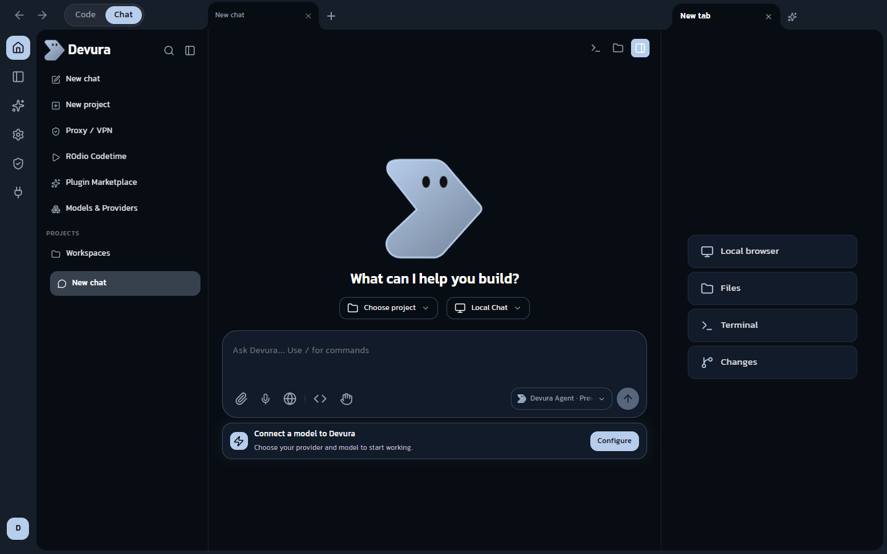
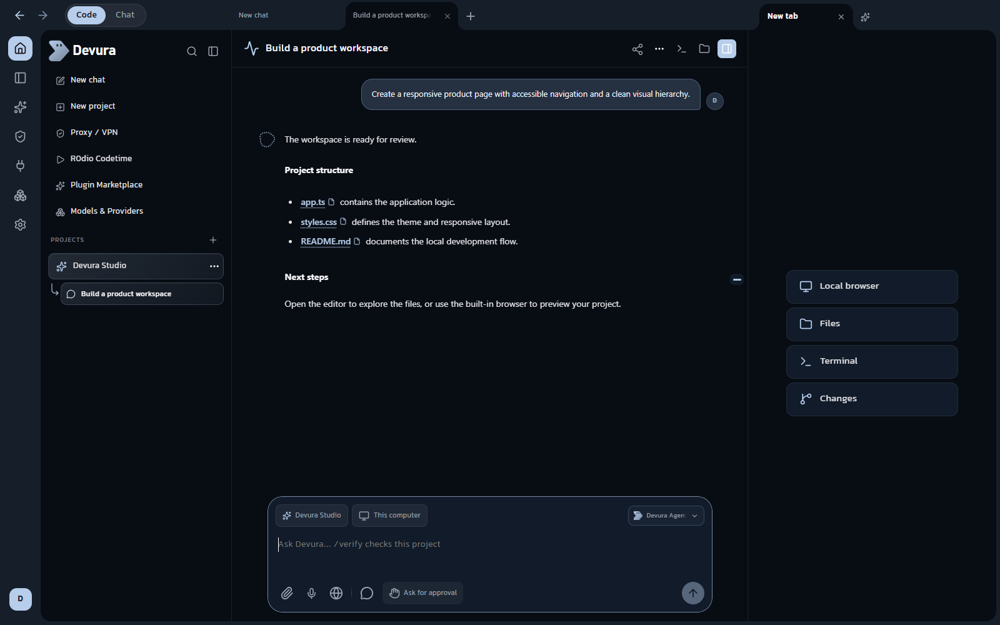
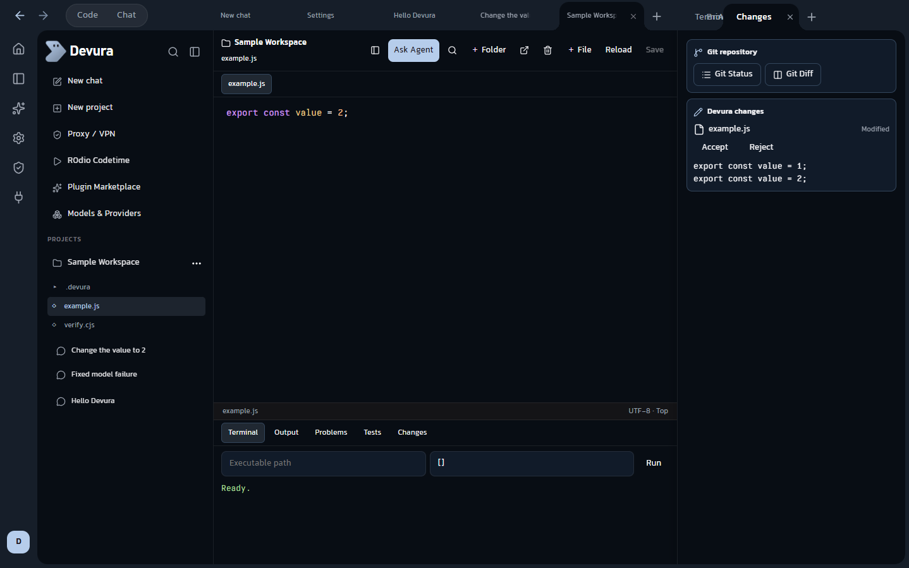

<h1 align="center">Devura · دوورا</h1>

<strong>کد شما. سرعت شما. دوورا.</strong>

مدل‌ها، پروژه‌ها، ویرایشگر، ترمینال و مرورگر؛ در یک فضای کاری.

<a href="https://devura.me/fa">وب‌سایت</a> · <a href="https://devura.me/docs">مستندات</a> · <a href="https://github.com/parsico/devura/releases">نسخه‌ها</a> · <a href="https://github.com/parsico/devura/issues">پشتیبانی</a>

## فضای کاری شما، یکپارچه

| بخش | امکانات |
| --- | --- |
| **پروژه‌ها و گفتگوها** | پوشه‌ها، چت‌ها و اطلاعات پروژه را کنار هم نگه دارید. |
| **حساب‌ها و مدل‌ها** | حساب ایجنت‌های برنامه‌نویسی یا ارائه‌دهندهٔ مدل خودتان را متصل کنید. |
| **ویرایشگر، ترمینال و مرورگر** | فایل‌ها را بررسی و ویرایش کنید، دستور اجرا کنید و نتیجهٔ وب را ببینید. |
| **فعالیت‌ها و کارهای پس‌زمینه** | اجرای ابزارها، خروجی بیلد و پیشرفت واقعی کارها را دنبال کنید. |
| **اسکیل‌ها و پلاگین‌ها** | گردش‌کارها و ابزارهای متصل را به پروژه اضافه کنید. |
| **اشتراک‌گذاری و هاست** | گفتگوها را به اشتراک بگذارید و فایل‌های سی‌پنل را مستقیم مدیریت کنید. |

دسترسی و محدودیت مصرف هر سرویس به حساب و ارائه‌دهندهٔ متصل بستگی دارد.

## دانلود دوورا

| پلتفرم | وضعیت | دریافت |
| --- | --- | --- |
| ویندوز ۶۴ بیت | **نسخهٔ 0.3.28** | [دانلود فایل نصبی](https://github.com/parsico/devura/releases/download/v0.3.28/Devura-Setup-0.3.28.exe) |
| مک | **به‌زودی** | هنوز منتشر نشده است |
| لینوکس | **به‌زودی** | هنوز منتشر نشده است |

فایل **Devura-Setup-0.3.28.exe** را اجرا و مراحل نصب را دنبال کنید. در نسخه‌های قبلی ویندوز، بررسی آپدیت داخل برنامه هم در دسترس است. هش SHA-256 فایل در [یادداشت انتشار](https://github.com/parsico/devura/releases/tag/v0.3.28) قرار دارد.

## نگاهی به برنامه

| گفتگو و ابزارها | ویرایشگر و بررسی تغییرات |
| :---: | :---: |
|  |  |

## شروع سریع

1. نسخهٔ ویندوز را دانلود و نصب کنید.
2. پوشهٔ پروژه‌تان را باز کنید.
3. حساب برنامه‌نویسی یا ارائه‌دهندهٔ مدل دلخواه را متصل کنید.
4. درخواستتان را بنویسید و تغییرات و فعالیت ابزارها را ببینید.

## دربارهٔ این مخزن

این مخزن عمومی شامل نسخه‌های برنامه، راهنما و [نمونهٔ مستقل رابط کاربری](examples/desktop-preview) است. موتور برنامه و بک‌اند اختصاصی هستند و در این مخزن قرار ندارند. برای استفاده از برنامهٔ کامل، فایل نصبی را دریافت کنید.

<a href="https://devura.me/fa">وب‌سایت دوورا ↗</a> · <a href="https://github.com/parsico/devura/issues">گزارش مشکل</a> · <a href="README.md">Read in English</a>

