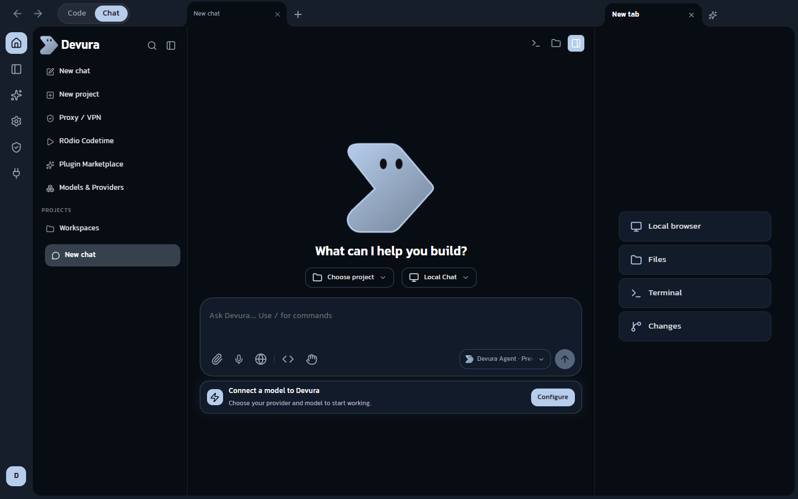

<h1 align="center">Devura</h1>

<strong>Your code. Your pace. Devura.</strong>

Your projects, coding agents, editor, terminal and browser — together.

 

<a href="https://devura.me">Website</a> · <a href="https://devura.me/docs">Documentation</a> · <a href="README.fa.md">Persian</a>

## Your workspace

- Connect coding accounts and use your own model providers.
- Work with project files, a code editor, terminal and built-in browser.
- Review Agent changes and follow real background jobs in Activity.
- Discover Skills and plugins, and share project conversations.
- Manage cPanel files and upload build assets through direct hosting tools.

Features and service availability depend on your account, provider and configuration.

## Download

| Platform | Availability |
| --- | --- |
| Windows x64 | [Download Devura 0.3.28](https://github.com/parsico/devura/releases/download/v0.3.28/Devura-Setup-0.3.28.exe) |
| macOS | Coming soon |
| Linux | Coming soon |

Run the Windows installer and follow the setup steps. Existing installations can check for updates inside Devura. Release notes include the installer SHA-256 checksum.

## Gallery

| Agent workspace | Code review |
| --- | --- |
|  |  |

## This repository

This is the public distribution, documentation and UI examples repository. `examples/desktop-preview` is a standalone visual sample; it does not include the proprietary desktop engine, account integrations or backend. It is not a buildable copy of the full application.

For the complete application, install the published release. [Report an issue](https://github.com/parsico/devura/issues).
