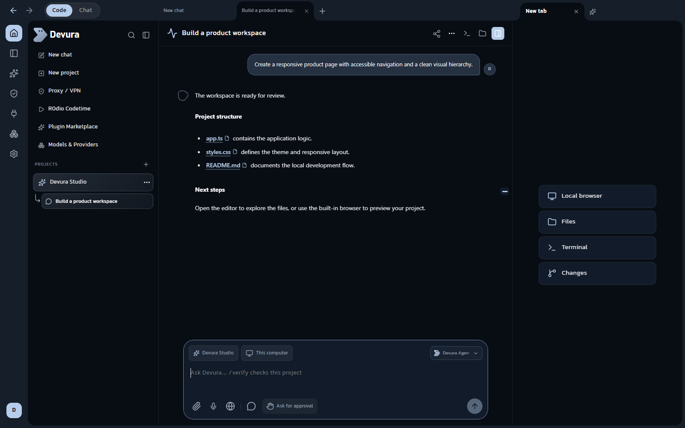
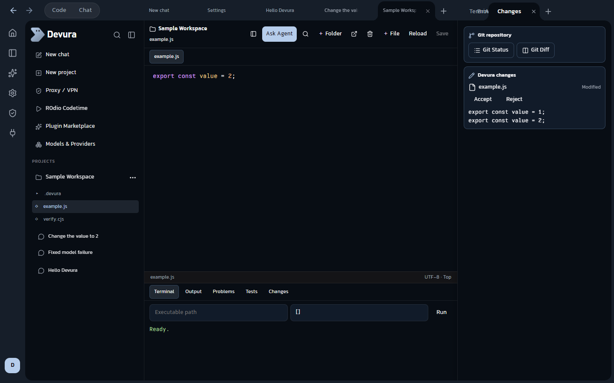

<h1 align="center">Devura</h1>

<strong>Your code. Your pace. Devura.</strong>

Your models, projects, editor, terminal and browser in one AI coding workspace.

<a href="https://devura.me">Website</a> · <a href="https://devura.me/docs">Documentation</a> · <a href="https://github.com/parsico/devura/releases">Releases</a> · <a href="https://github.com/parsico/devura/issues">Support</a>

## Your workspace, connected

| | |
| --- | --- |
| **Projects & conversations** | Keep your folders, chats and working context together. |
| **Coding accounts & models** | Connect coding accounts or configure your own model providers. |
| **Editor, terminal & browser** | Inspect files, edit code, run commands and verify web output. |
| **Activity & background jobs** | Follow Agent actions, build output and real task progress. |
| **Skills & plugins** | Add focused workflows and connected tools to your projects. |
| **Sharing & hosting** | Share conversations and manage cPanel files with direct hosting tools. |

Service availability and usage limits depend on the connected account and provider.

## Download Devura

| Platform | Status | Download |
| --- | --- | --- |
|  | **0.3.28 · Windows x64** | [Download installer](https://github.com/parsico/devura/releases/download/v0.3.28/Devura-Setup-0.3.28.exe) |
| macOS | **Coming soon** | Not available yet |
| Linux | **Coming soon** | Not available yet |

Run **Devura-Setup-0.3.28.exe** and follow the setup steps. Existing Windows installations can check for updates inside Devura. The installer SHA-256 checksum is included in the [release notes](https://github.com/parsico/devura/releases/tag/v0.3.28).

## A closer look

| Conversations & tools | Editor & code review |
| :---: | :---: |
|  |  |

## Get started

1. Download and install the Windows app.
2. Open a project folder.
3. Connect a coding account or choose your model provider.
4. Describe your task and follow the changes in your workspace.

## About this repository

This public repository contains releases, documentation and a [standalone UI example](examples/desktop-preview). The application engine and backend are proprietary and are not included here. Use the published installer for the complete application.

<a href="https://devura.me">Explore Devura ↗</a> · <a href="https://github.com/parsico/devura/issues">Report an issue</a> · <a href="README.fa.md">مطالعه به فارسی</a>

